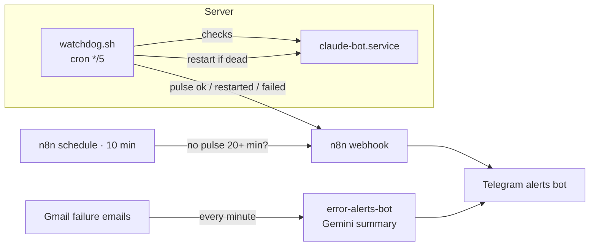

# Automation Alerts & Server Watchdog

Two small systems that tell me in Telegram when something breaks — before I notice it myself.

## 1. Error alerts (`error-alerts-bot`)
Every minute n8n checks Gmail for failure notifications from any service — Apps Script, n8n, Make, Zapier, GitHub Actions, payments, bounced mail. Gemini turns each email into a one-line alert in plain words with a severity (🔴 critical · 🟡 medium · 🟢 low). If the AI step fails, the raw subject is sent anyway — no alert gets lost.

## 2. Server watchdog (`server/watchdog.sh` + `server-watchdog`)
My Telegram AI assistant runs on a small Linux server inside tmux under systemd. systemd only knows whether tmux is alive — not whether the bot can actually hear Telegram. So:

- **Every 5 minutes** a cron script checks the service, the tmux session, the Claude process and the Telegram plugin process inside the service's cgroup.
- If something is dead → restarts the service (passwordless sudo for exactly one command), re-checks after 60 s, max 3 restarts per hour, then escalates once.
- Every run sends a **pulse** to an n8n webhook. n8n alerts on `restarted` / `failed`, and if no pulse arrives for 20+ minutes it reports that the whole server is down — and again when it's back.

## Stack
n8n (Gmail trigger, AI Agent, Webhook, Schedule, workflow static data) · Google Gemini · Bash · systemd · cron · cgroups

## Setup
1. Import `workflows/*.json`, connect Gmail, Gemini and a Telegram bot.
2. Replace `YOUR_PULSE_KEY`, `YOUR_TELEGRAM_CHAT_ID`, `your-instance.app.n8n.cloud`.
3. On the server: copy `server/watchdog.sh`, create `.env` with `PULSE_KEY`, add a sudoers rule for `systemctl restart <your-service>` via `visudo`, add the cron line.

---
Built by Anastasiia Ukrainska · [Portfolio](https://app.notion.com/p/Anastasiia-Ukrainska-AI-Automator-3c61a7c286c881c7b3f0e59620343c67)
